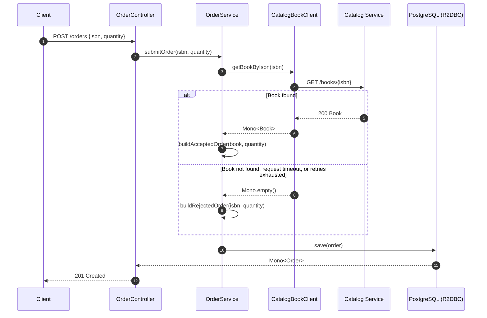

# Chapter 8 – Reactive Spring: Resilience and Scalability

This chapter introduces reactive programming for building cloud-native applications that are scalable, efficient, and resilient when handling I/O-bound work such as database access and service-to-service communication.

You will start building the **Order Service** for Polar Bookshop with Spring Boot, Spring WebFlux, and Spring Data R2DBC.\
The application uses Project Reactor’s `Mono` and `Flux` types, persists data through R2DBC, and exposes a non-blocking REST API.

Order Service also calls Catalog Service through a reactive HTTP client to get book details and check availability.\
Along the way, this chapter applies resilience patterns (timeouts, retries with exponential backoff, fallbacks, and error handling) to make remote calls more robust.\
Finally, it covers testing reactive REST clients, data persistence, and controllers with Spring, Reactor `StepVerifier`, MockWebServer, and Testcontainers.

Original source code: [Thomas Vitale's Chapter 8 final project](https://github.com/ThomasVitale/cloud-native-spring-in-action/tree/main/Chapter08/08-end).

> [!NOTE]
> This project differs from the book in a few ways:
>
> - **Order Service is written in Kotlin**; Catalog Service and Config Service remain Java.
> - The Catalog client is a declarative **HTTP Interface** (`@HttpExchange`) backed by `WebClient` through `WebClientAdapter` and `HttpServiceProxyFactory`. The book calls `WebClient` directly.
> - Tests use **OkHttp `mockwebserver3`** and **MockK/SpringMockK**. BlockHound is available on the test classpath.
> - The stack targets **Spring Boot 4.1** and **Spring Cloud 2025.1**, which use Jackson 3 (`tools.jackson.*`).

---

All commands start from **`Chapter08/`**.

Make sure that you are in `Chapter08` directory.

```console
→ pwd
/path/to/cloud-native-spring-in-action/Chapter08
```

## What is in this chapter?

| Directory                             | Purpose                                                                                                                     |
|---------------------------------------|-----------------------------------------------------------------------------------------------------------------------------|
| [config-service/](config-service)     | Spring Cloud Config Server on port `8888`                                                                                   |
| [catalog-service/](catalog-service)   | Catalog API on port `9001` (Java); gets external configuration from Config Service and persists books through JDBC          |
| [order-service/](order-service)       | Reactive Order API on port `9002` (Kotlin); checks book availability with Catalog Service and persists orders through R2DBC |
| [config-repo/](config-repo)           | Configuration served by Config Service, local mirror of [fResult-PolarBookshop/config-repo][org-config-repo]                |
| [polar-deployment/](polar-deployment) | Docker Compose and Kubernetes manifests, including the aggregate development Tiltfile                                       |

PostgreSQL hosts two databases: `polardb_catalog` for Catalog Service and `polardb_order` for Order Service.\
Both Compose (`docker/postgresql/init.sql`) and Kubernetes (the `postgres-config` ConfigMap) create them on first start.

The Config Server reads the remote [fResult-PolarBookshop/config-repo][org-config-repo] Git repository, not the local `config-repo/` mirror, so it needs internet access.\
Changes to the local mirror have no effect until you push them to the remote repository.

## How Order Service works



Order Service always persists the order and returns `201 Created`.\
The `status` field carries the business result: `ACCEPTED` when Catalog returns the book, and `REJECTED` otherwise.\
An accepted order stores `bookName` as `"<title> - <author>"` and copies the book price.

### Resilience layers on the Catalog call

Several layers wrap the remote call. Read them from the network outward:

| Layer                            | Where                             | Behavior                                                                                                                             |
|----------------------------------|-----------------------------------|--------------------------------------------------------------------------------------------------------------------------------------|
| Connect and response timeouts    | `catalogServiceHttpClient` bean   | Reactor Netty `CONNECT_TIMEOUT_MILLIS` and `responseTimeout` from `polar.catalog-service.connect-timeout` / `response-timeout`       |
| Per-attempt timeout and fallback | `CatalogBookClient.getBookByIsbn` | Each attempt gets 2s by default, 3s with `prod`; a slow attempt completes empty and stops the sequence, so slowness is never retried |
| `404 Not Found` fallback         | `CatalogBookClient.getBookByIsbn` | An unknown ISBN completes empty instead of raising an error                                                                          |
| Client retry                     | `CatalogBookClient.getBookByIsbn` | `Retry.backoff(3, 100ms)` for `5xx` responses and connection failures (`ConnectException`)                                           |
| Final fallback                   | `CatalogBookClient.getBookByIsbn` | Any remaining exception completes empty                                                                                              |
| Business fallback                | `OrderService.submitOrder`        | `switchIfEmpty` builds a `REJECTED` order                                                                                            |

`CatalogServiceProperties` defaults to a 3s connect timeout and a 5s response timeout.\
The `config-repo` lowers both to `2s` (default profile) or `3s` (`prod` profile).\
The per-attempt timeout sits upstream of `retryWhen`, so it applies to each attempt, not to the whole call.\
A slow Catalog produces a `REJECTED` order after one timeout, while fast failures (such as connection refused) are retried with backoff before the fallback applies.

## Prerequisites

- **JDK 25** and the included Gradle wrappers (a separate Gradle installation is unnecessary)
- **SDKMAN!** to install the JDK pinned in each project's `.sdkmanrc` (recommended; any JDK 25 distribution also works)
- **Docker Desktop** or **Docker Engine** running locally. Testcontainers also uses it during `./gradlew test`
- **`kubectl`**, **Minikube**, and **Tilt**
- **HTTPie** or **`curl`** for the API request examples
- *Optional:* **Headlamp Desktop** for visual inspection and **Kubeconform** for manifest validation

> [!TIP]
> Each project pins its JDK in `.sdkmanrc` (`25.0.5.0+11-librca`).\
> Install [SDKMAN!](https://sdkman.io/install) if you do not have it yet:
>
> ```bash
> curl -s "https://get.sdkman.io" | bash
> ```
>
> Then run `sdk env install` inside a project directory to install that JDK, and `sdk env` to use it in the current shell.\
> All three projects pin the same version, so installing it once is enough.\
> To switch automatically when you `cd` into a project, set `sdkman_auto_env=true` in `~/.sdkman/etc/config`.

On macOS, install the core tools with Homebrew:

```bash
brew install kubectl minikube tilt
brew install --cask headlamp # optional
kubectl version --client
minikube version
tilt version
```

On Linux or Windows, install the equivalent tools using the official [kubectl](https://kubernetes.io/docs/tasks/tools/), [Minikube](https://minikube.sigs.k8s.io/docs/start/), and [Tilt](https://docs.tilt.dev/install.html) instructions.\
The Tilt image helper scripts use a POSIX shell, so native Windows needs an equivalent script or WSL.

> [!NOTE]
> Docker Desktop and the `polar` Minikube profile keep separate image stores.\
> The Tilt build helpers load each generated image into Minikube, because the cluster cannot pull an image that exists only in host Docker.

## Run the applications on the host

Use this path when you want to run the three Spring Boot applications directly on the local machine with `bootRun`.\
Docker Compose provides only PostgreSQL here.

Startup dependencies:

- **Config Service** has no dependencies.
- **Catalog Service** needs Config Service (`fail-fast`) and PostgreSQL.
- **Order Service** needs Config Service (`fail-fast` with retry) and PostgreSQL. It calls Catalog Service only when it handles a request, so Catalog does not need to run first. Without Catalog, every order becomes `REJECTED`.

### 1. Start PostgreSQL

```console
→ docker compose -f polar-deployment/docker/compose.yml up -d polar-postgres
[+] up 1/1
 ✔ Container polar-postgres Started
```

### 2. Start the applications

Open a separate terminal for each application and keep it running.\
Start Config Service first and wait until it is ready.

```bash
(cd config-service && ./gradlew bootRun)
```

```bash
(cd catalog-service && ./gradlew bootRun)
```

```bash
(cd order-service && ./gradlew bootRun)
```

[`catalog-service/build.gradle.kts`][catalog-bootrun-task-config] runs `bootRun` with the `testdata` profile, so Catalog loads `1234567891` (*Northern Lights*) and `1234567892` (*Polar Journey*) at startup.\
`BookDataLoader` deletes every book before loading them, so books you create yourself disappear when Catalog restarts.\
Order connects to `r2dbc:postgresql://localhost:5432/polardb_order` and runs its Flyway migrations over JDBC on the same database.

### 3. Exercise the Order API

`OrderController` exposes `GET /orders` and `POST /orders`.\
Submit an order for a preloaded book, then one for an unknown ISBN, and list them:

```bash
http POST :9002/orders isbn=1234567891 quantity:=1
```

```bash
http POST :9002/orders isbn=1234567899 quantity:=3
```

```bash
http :9002/orders
```

<details>
<summary>Equivalent <code>curl</code> commands</summary>

```bash
curl --fail-with-body -i -X POST http://localhost:9002/orders \
  -H 'Content-Type: application/json' \
  --data '{"isbn":"1234567891","quantity":1}'

curl --fail-with-body http://localhost:9002/orders
```

</details>

Both `POST /orders` requests return `201 Created`.\
The first order is `ACCEPTED`; the second is `REJECTED` with `bookName` and `bookPrice` set to `null`.

> [!TIP]
> To order a book that is not preloaded, create it in Catalog first:
>
> ```console
> → http POST :9001/books isbn=1234567890 title="Cloud Native Spring in Action" author="Thomas Vitale" price:=39.90 publisher=Manning
> HTTP/1.1 201 Created
> ```
>
> With the `testdata` profile, `BookDataLoader` deletes every book when Catalog starts.\
> Create the book again after each Catalog restart.

`OrderRequest` validates the payload: `isbn` must not be blank, and `quantity` must be between `1` and `5`.\
For example, both of these requests return `400 Bad Request`:

```bash
http POST :9002/orders isbn="" quantity:=6
```

```bash
http POST :9002/orders isbn:=null quantity:=6
```

`GlobalExceptionHandler` returns an RFC 9457 Problem Detail (`application/problem+json`), and its `arguments` field lists each violated constraint:

```console
→ http POST :9002/orders isbn="" quantity:=6
HTTP/1.1 400 Bad Request
Content-Type: application/problem+json
{
  "arguments": {
    "isbn": "The book ISBN must be defined.",
    "quantity": "You cannot order more than 5 items."
  },
  "instance": "/orders",
  "status": 400,
  "title": "Bad Request"
}
```

### 4. Observe the fallback

Stop Catalog Service (<kbd>Ctrl</kbd> + <kbd>C</kbd> in its terminal) and submit the first order again:

```bash
http POST :9002/orders isbn=1234567891 quantity:=1
```

The response is still `201 Created`, but the order is now `REJECTED`.\
The connection failure exhausts the retries, the fallback completes empty, and `OrderService` builds a rejected order.

### 5. Stop PostgreSQL

```bash
docker compose -f polar-deployment/docker/compose.yml down --volumes polar-postgres
```

`docker compose down` accepts service names, so this command targets only `polar-postgres`.\
The Compose file does not declare a named volume for PostgreSQL, so the next `up` would not reuse the image's anonymous data volume anyway.\
`--volumes` removes it instead of leaving it orphaned.\
The next start runs `init.sql` again and creates empty databases.

## Run the tests

Run every Order Service test. The Testcontainers-based tests need Docker:

```bash
(cd order-service && ./gradlew test)
```

The Gradle `test` task sets `spring.cloud.config.enabled=false`, so tests do not need a running Config Server.

| Test class                                | Focus                                                                                                                                         |
|-------------------------------------------|-----------------------------------------------------------------------------------------------------------------------------------------------|
| `CatalogBookClientTest`                   | Reactive HTTP client with MockWebServer and `StepVerifier`: books, empty results, `404` fallback without retry, `503` retry, timeout fallback |
| `CatalogServicePropertiesTest`            | `polar.catalog-service.*` binding with `ApplicationContextRunner`: URI and timeouts, missing `uri` fails startup, unknown keys are ignored    |
| `OrderRepositoryR2dbcTest`                | R2DBC persistence against a Testcontainers PostgreSQL                                                                                         |
| `OrderServiceTest`                        | Accepted and rejected order flows                                                                                                             |
| `OrderControllerWebFluxTest`              | WebFlux controller slice                                                                                                                      |
| `OrderJsonTest`, `OrderRequestJsonTest`   | JSON serialization and deserialization                                                                                                        |
| `OrderRequestValidationTest`, `OrderTest` | Bean Validation constraints and the `Order` model                                                                                             |
| `OrderServiceApplicationTests`            | Full application context startup                                                                                                              |

To run only the HTTP client test:

```bash
(cd order-service && ./gradlew test --tests CatalogBookClientTest)
```

## Develop the complete environment with Tilt

Use this path when you want the applications to run in the local Minikube cluster.\
First stop the Compose PostgreSQL container if it is still running.\
If both run at the same time, host port `5432` and the database state become confusing, and host resources stay allocated for nothing.

```bash
docker compose -f polar-deployment/docker/compose.yml down --volumes polar-postgres
```

Make sure Docker is running, then start and select the `polar` Minikube context:

```bash
minikube start --cpus 2 --memory 4g --driver docker --profile polar
kubectl config use-context polar
kubectl get nodes
```

Deploy PostgreSQL before starting Tilt.\
It is a platform service, so it stays outside Tilt's application development boundary and remains available across `tilt down` / `tilt up` cycles.

```bash
kubectl apply -f polar-deployment/kubernetes/platform/development/services/postgresql.yml
kubectl rollout status deployment/polar-postgres
```

Then start the aggregate development environment:

```bash
tilt up -f polar-deployment/kubernetes/applications/development/Tiltfile
```

> [!NOTE]
> The first `tilt up` may take **several minutes**.\
> Tilt builds the three images one at a time with Cloud Native Buildpacks, loads them into Minikube, and then deploys them.\
> Press <kbd>Space</kbd> in the `tilt up` terminal to open the Tilt UI at <http://localhost:10350>.\
> Continue when `config-service`, `catalog-service`, and `order-service` are all green.

The aggregate Tiltfile includes the Config, Catalog, and Order Tiltfiles.\
It serializes image builds (`max_parallel_updates=1`) so that a small Docker/Minikube setup does not get overloaded.

Tilt provides these local port forwards:

| Resource        | Local URL               | In-cluster Service            |
|-----------------|-------------------------|-------------------------------|
| Config Service  | <http://localhost:8888> | `config-service:80` → `8888`  |
| Catalog Service | <http://localhost:9001> | `catalog-service:80` → `9001` |
| Order Service   | <http://localhost:9002> | `order-service:80` → `9002`   |
| PostgreSQL      | no forward by default   | `polar-postgres:5432`         |

Inside the cluster, Order Service uses these environment variables from `order-service/k8s/deployment.yml`:

| Variable                    | Value                                             |
|-----------------------------|---------------------------------------------------|
| `POLAR_CATALOG_SERVICE_URI` | `http://catalog-service`                          |
| `SPRING_CLOUD_CONFIG_URI`   | `http://config-service`                           |
| `SPRING_R2DBC_URL`          | `r2dbc:postgresql://polar-postgres/polardb_order` |
| `SPRING_FLYWAY_URL`         | `jdbc:postgresql://polar-postgres/polardb_order`  |

### Verify the deployment

```bash
kubectl get all -l 'app in (config-service,catalog-service,order-service)'
kubectl get all -l db=polar-postgres
kubectl get endpointslices
```

Check Order Service health through the Tilt port forward:

```console
→ http :9002/actuator/health
HTTP/1.1 200 OK
Content-Type: application/vnd.spring-boot.actuator.v3+json
{
  "groups": [
    "liveness",
    "readiness"
  ],
  "status": "UP"
}
```

In Kubernetes, Catalog runs with the `testdata` profile, which loads `1234567891` (*Northern Lights*) and `1234567892` (*Polar Journey*) at startup.\
Order those books directly:

```console
→ http POST :9002/orders isbn=1234567892 quantity:=5
HTTP/1.1 201 Created
{
  "bookIsbn": "1234567892",
  "bookName": "Polar Journey - Iorek Polason",
  "bookPrice": 12.9,
  "createdDate": "2026-11-01T11:15:02.322241965Z",
  "id": 1,
  "lastModifiedDate": "2026-11-01T11:15:02.322241965Z",
  "quantity": 5,
  "status": "ACCEPTED",
  "version": 1
}
```

```console
→ http POST :9002/orders isbn=1234567899 quantity:=3
HTTP/1.1 201 Created
{
  "bookIsbn": "1234567899",
  "bookName": null,
  "bookPrice": null,
  "createdDate": "2026-11-02T13:05:00.548614765Z",
  "id": 2,
  "lastModifiedDate": "2026-11-02T13:05:00.548614765Z",
  "quantity": 3,
  "status": "REJECTED",
  "version": 1
}
```

```bash
http :9002/orders
```

IDs and timestamps change on each run.\
Do not rely on their exact values.

### Observe the fallback in Kubernetes

Remove every Catalog Pod, submit an order for an existing book, then restore Catalog:

```bash
kubectl scale deployment/catalog-service --replicas=0
```

```bash
http POST :9002/orders isbn=1234567891 quantity:=1
```

```bash
kubectl scale deployment/catalog-service --replicas=1
```

```bash
kubectl rollout status deployment/catalog-service
```

The order is `REJECTED` while the Service has no endpoints.\
After Catalog is ready again, the same request is `ACCEPTED`.\
Tilt may report the scaled-down resource as unhealthy until the Pod returns.

### Fast development loop: Live Update

The Live Update workflow is the same as in [Chapter 7](../Chapter07/README.md#fast-development-loop-live-update).\
Order Service is a Kotlin project, so Tilt watches `build/classes/kotlin/main` and `build/resources/main` instead of the Java class directory.

```bash
(cd order-service && ./gradlew classes --continuous)
```

Validate the Tilt configuration without deploying it:

```bash
tilt alpha tiltfile-result -f polar-deployment/kubernetes/applications/development/Tiltfile
```

## Troubleshooting

| Symptom                                                   | Likely cause                                                                                   | Check or correction                                                                                                |
|-----------------------------------------------------------|------------------------------------------------------------------------------------------------|--------------------------------------------------------------------------------------------------------------------|
| Order Service exits at startup with a Config Client error | Config Service is not reachable and `fail-fast` is enabled                                     | Start Config Service first; inspect `kubectl logs deployment/config-service`.                                      |
| Every order is `REJECTED`, even for existing books        | Order cannot reach Catalog or the call exceeds 2s                                              | Check `POLAR_CATALOG_SERVICE_URI`, `kubectl get endpointslices -l app=catalog-service`, and the Order logs.        |
| `ACCEPTED` expected on the host but `REJECTED` returned   | The ISBN is not preloaded, or Catalog restarted and `BookDataLoader` removed books you created | Use `1234567891` or `1234567892`, or create the book again with `POST :9001/books`.                                |
| `400 Bad Request` from `POST /orders`                     | `isbn` is blank, or `quantity` is outside `1..5`                                               | Fix the payload; the response body names the violated constraint.                                                  |
| `R2dbcNonTransientResourceException` / database errors    | `polardb_order` does not exist                                                                 | The init script runs only on the first start of an empty data directory; recreate the PostgreSQL container or Pod. |
| `ErrImagePull` / `ImagePullBackOff`                       | Image exists only in host Docker                                                               | Confirm the helper completed `minikube image load`; inspect `minikube image ls --profile polar`.                   |
| Gradle reports no matching toolchain                      | No JDK 25 is installed, and toolchain auto-provisioning is not configured                      | Run `sdk env install` in the project directory, or install another JDK 25 distribution.                            |
| `./gradlew test` fails before the tests run               | Docker is not running, so Testcontainers cannot start PostgreSQL                               | Start Docker and retry.                                                                                            |

Use this short diagnostic sequence before guessing:

```bash
kubectl get pods
kubectl get endpointslices -l 'app in (catalog-service,order-service)'
kubectl describe pod <pod-name>
kubectl logs deployment/order-service
kubectl logs deployment/catalog-service
```

## Validate manifests and clean up

Validate every manifest used by the aggregate environment:

```bash
kubeconform --strict --summary --verbose \
  config-service/k8s \
  catalog-service/k8s \
  order-service/k8s \
  polar-deployment/kubernetes/platform/development/services/postgresql.yml
```

The command prints one line per resource, followed by this summary:

```text
Summary: 9 resources found in 7 files - Valid: 9, Invalid: 0, Errors: 0, Skipped: 0
```

Tear down the applications with the aggregate Tiltfile.\
Then delete the platform service separately and stop the cluster:

```bash
tilt down -f polar-deployment/kubernetes/applications/development/Tiltfile
kubectl delete -f polar-deployment/kubernetes/platform/development/services/postgresql.yml
minikube stop --profile polar
```

> [!CAUTION]
> The following commands remove **every matching Tilt-tagged service image** from Docker and the `polar` Minikube image store.\
> Inspect the listed images first, and do not run them if another project uses matching tags.
>
> ```bash
> docker images --format '{{.Repository}}:{{.Tag}}' | grep -E '^(catalog|config|order)-service:tilt-'
> minikube image ls --profile polar | grep -E '(catalog|config|order)-service:tilt-'
> ```
>
> After reviewing the list, remove the images:
>
> ```bash
> docker images --format '{{.Repository}}:{{.Tag}}' | grep -E '^(catalog|config|order)-service:tilt-' | xargs -r docker rmi
> minikube image ls --profile polar | grep -E '(catalog|config|order)-service:tilt-' | xargs -r minikube --profile polar image rm
> ```
>
> The safer alternative is to delete one reviewed image at a time: `docker rmi <image_name|image_id>` or `minikube image rm <image_name|image_id> --profile polar`.

[org-config-repo]: https://github.com/fResult-PolarBookshop/config-repo
[catalog-bootrun-task-config]: https://github.com/fResult/cloud-native-spring-in-action/blob/0bce7e014d443bfb7041ca6bea985232bd780e16/Chapter08/catalog-service/build.gradle.kts#L125-L127

---

<footer>
  <div align=center>
    <br><br>.<br><br>.<br><br>.<br><br>.<br><br>.<br><br>.<br><br>.<br><br>.<br><br>.<br><br>.<br><br>.<br><br>.<br><br>.<br><br>.<br><br>
  </div>

  <p align=center>
    [This Space Intentionally Left Blank]
  </p>

  <p align=center>
    The bottom of every page is padded so readers can maintain a consistent eyeline.
  </p>
</footer>
